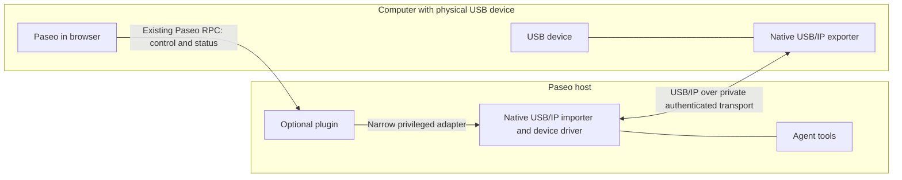

# Browser-controlled USB/IP investigation

Status: proposal, checked 2026-10-19. Paseo does not implement this feature.

The target is to use a USB device connected to the browser user's computer from
an application on a remote Paseo host, using that host's normal USB driver.
A browser device picker, a serial byte stream, or flashing firmware in JavaScript
does not meet that requirement.

**An ordinary Chrome/Brave page cannot export arbitrary USB devices.** Plan on a
native exporter beside the physical device and a virtual host controller on the
receiving machine. Use the browser as the control surface. An optional plugin
is the appropriate place to investigate that integration. Installed Isolated
Web Apps have a separate privileged API path described below.

## Browser limits

| Approach                                                               | What it provides                                     | Why it cannot cover arbitrary USB/IP                                                                                                                                                                                                                                        |
| ---------------------------------------------------------------------- | ---------------------------------------------------- | --------------------------------------------------------------------------------------------------------------------------------------------------------------------------------------------------------------------------------------------------------------------------- |
| [WebUSB](https://wicg.github.io/webusb/)                               | Transfers to browser-approved USB interfaces         | Ordinary pages cannot claim protected classes including HID, mass storage, audio, and video. A chooser grant does not lift those restrictions. A USB/IP exporter would also have to translate descriptors, control requests, transfer completion, cancellation, and errors. |
| [Web Serial](https://wicg.github.io/serial/)                           | Bytes and serial control signals for supported ports | It does not expose a complete USB device, its other interfaces, or USB request blocks.                                                                                                                                                                                      |
| [WebHID](https://wicg.github.io/webhid/)                               | Reports for permitted HID collections                | Protected usages remain blocked; reports do not provide general USB access.                                                                                                                                                                                                 |
| [Direct Sockets](https://developer.chrome.com/docs/iwa/direct-sockets) | TCP/UDP in installed Isolated Web Apps               | This is not an API available to an ordinary Paseo web page, and sockets do not remove hardware API restrictions.                                                                                                                                                            |

[Chrome's WebUSB guide](https://developer.chrome.com/docs/capabilities/usb)
requires a secure context and user activation for device selection. Selection
grants access to the web origin, not to a remote operating system. A WebSocket
can carry bytes, but a native USB/IP peer expects its own TCP protocol. A
WebSocket-to-TCP adapter solves only that transport mismatch.

Do not infer support from a Chromium browser name. Check the actual APIs and
policies. For example, [Brave disables Web Serial by default](https://github.com/brave/brave-browser/wiki/Deviations-from-Chromium-%28features-we-disable-or-remove%29).
Browser extensions, Electron permissions, and native messaging require separate
installation and authority; none is a portable browser-only solution.

The WebUSB specification defines an exception:
[`usb-unrestricted`](https://github.com/WICG/webusb/blob/main/unrestricted-usb-explainer.md)
allows installed Isolated Web Apps to access blocklisted devices and protected
classes. Together with Direct Sockets, this is a candidate for a separately
packaged USB redirection app. It still needs a USB/IP translation implementation,
OS-specific device access, a native importer, and compatibility testing. An
ordinary web page cannot enable it with a Permissions Policy header, and a
normal PWA install does not turn Paseo into an IWA. No Chrome/Brave cross-platform
IWA deployment or USB/IP implementation was validated here. Treat this as a
separate distribution option, not evidence that the existing web app supports it.

## Existing implementations

USB/IP calls the machine with the physical device the **server/exporter** and
the machine running the device driver the **client/importer**. For this workflow,
the remote Paseo host is the USB/IP client. Keep those roles explicit in code and
UI; they are the reverse of the Paseo browser/daemon naming.

The [Linux protocol documentation](https://docs.kernel.org/usb/usbip_protocol.html)
defines device listing and import over TCP, followed by USB request submission,
completion, and unlink messages on the imported device's connection. The
receiving machine needs a virtual host controller and the relevant device driver.

| Candidate                                                                                                                                                    | Role                                                                       | Assessment                                                                                                                                                                                                                                                     |
| ------------------------------------------------------------------------------------------------------------------------------------------------------------ | -------------------------------------------------------------------------- | -------------------------------------------------------------------------------------------------------------------------------------------------------------------------------------------------------------------------------------------------------------- |
| [Linux USB/IP](https://github.com/torvalds/linux/tree/master/tools/usb/usbip)                                                                                | Native exporter and importer (`usbip-host`, `usbipd`, `vhci-hcd`, `usbip`) | Start here for a Linux-to-Linux experiment. Reuse the kernel implementation rather than translating USB requests in TypeScript. Requires suitable kernels, userspace tools, and privileged setup.                                                              |
| [usbipd-win](https://github.com/dorssel/usbipd-win)                                                                                                          | Windows exporter                                                           | Existing service, CLI, and driver. Its documented non-WSL receiver is a Linux USB/IP client. Sharing requires administrator setup and persists across reboots; disconnect alone must not be treated as revocation. Its installer adds a firewall rule.         |
| [usbip-win2](https://github.com/vadimgrn/usbip-win2)                                                                                                         | Windows importer                                                           | Separate Windows virtual controller implementation. It does not replace the Windows exporter. Driver installation and device compatibility need independent validation.                                                                                        |
| [VirtualHere](https://www.virtualhere.com/usb_client_software)                                                                                               | Native USB sharing ecosystem                                               | A possible separately configured backend where its supported platforms are needed. It has its own deployment and licensing terms; do not assume wire compatibility with every USB/IP implementation. Its macOS client explicitly excludes microphones/webcams. |
| [esptool-js](https://github.com/espressif/esptool-js), [DAP.js](https://github.com/ARMmbed/dapjs), [Tango/ya-webadb](https://github.com/yume-chan/ya-webadb) | Device-specific browser workflows                                          | Useful precedents for browser hardware access. They implement device protocols rather than making arbitrary devices available to remote native drivers.                                                                                                        |

These are reuse candidates, not a supported-device matrix. Even native USB/IP
cannot promise every device: drivers, resets, composite interfaces, isochronous
traffic, bandwidth, and network latency need testing. The
[Linux USB/IP README](https://github.com/torvalds/linux/blob/master/tools/usb/usbip/README)
explicitly excludes exporting USB hubs. Keep macOS, mobile device
export, and containerized import uncommitted until a specific backend is proven.
For Docker, require host-kernel VHCI support and explicit exposure of the
resulting device into the agent container. Import and container access are
separate operations to validate.

## Paseo integration points

The current checkout has plugin settings, RPC, and process lifecycle support;
it has no browser USB/Serial/HID integration or native USB/IP adapter. The
public plugin registry was also checked for USB/serial/HID entries. No matching
integration was identified. GitHub issues, PRs, and Discussions were searched
for USB/IP, WebUSB, WebHID, serial ports, and passthrough; no directly related
implementation or tracking discussion was identified. This is a dated search
result, not a claim that no external integration exists.

Adjacent work is [PR #6534](https://github.com/getpaseo/paseo/pull/6534), open at
the time of this investigation. Its proposed credit-windowed TCP tunnel routes
desktop browser traffic through the daemon's network. Review that transport
before designing another one. It is not in this checkout's base, does not export
USB devices, and does not provide the reverse path from a daemon-side importer
to a browser-local exporter.

| Existing surface                                                                 | Reuse and boundary                                                                                                                                                                                                                       |
| -------------------------------------------------------------------------------- | ---------------------------------------------------------------------------------------------------------------------------------------------------------------------------------------------------------------------------------------- |
| [Plugin settings](plugins.md#contribute-settings), `plugin-examples/settings`    | An optional device manager belongs under Settings → Plugins → the USB plugin. Reuse the host shell and named settings components.                                                                                                        |
| `packages/plugin/src/client/contracts.ts`, `server/contracts.ts`, `rpc.ts`       | Typed RPCs can carry discovery, attach, detach, and status operations. Server code runs on the daemon machine; it cannot invoke a browser-local native executable. There is no public generic duplex byte-stream API in these contracts. |
| `packages/server/src/server/authorization/operation-permissions.ts`              | Plugin RPC invocation currently requires `daemon.manage`. It is not a separate per-device grant.                                                                                                                                         |
| `packages/plugin/src/server/contracts.ts:9`                                      | Handler context exposes the plugin's Paseo API, not the originating browser principal or its disconnect lifecycle. Plugin handlers cannot assume caller-specific ownership from this context.                                            |
| [Plugin lifecycle](plugins.md), `packages/server/src/server/plugins/runtime.ts`  | Own importer resources in server cleanup. Browser unmount and plugin teardown are different events; a browser loss needs an explicit lease.                                                                                              |
| [Service proxy](service-proxy.md), `packages/server/src/server/service-proxy.ts` | Proxies daemon-side HTTP/WebSocket services. It is not a client-local exporter, reverse TCP tunnel, or authenticated USB transport. Public service URLs do not inherit daemon API authentication.                                        |
| [Relay security](../SECURITY.md#relay-threat-model)                              | Existing app/daemon messages can use Paseo's encrypted relay. External USB/IP traffic does not acquire that protection automatically.                                                                                                    |

Follow the existing [plugin runtime boundaries](plugins.md#sdk-import-boundaries).
Keep device libraries and Node APIs out of shared/client code. Adding a core
settings page would not provide the missing exporter, importer, or data path.

## Proposed minimal architecture

This is an implementation direction, not an available feature:

Start with Linux export and Linux import over a user-configured authenticated
VPN or separately established OpenSSH port forward. Paseo's own SSH host
transport sets `ClearAllForwardings=yes`; it does not create that USB/IP route.
This avoids another USB implementation and leaves USB data
outside the browser and Paseo's JSON RPC queue. It needs a route from importer
to exporter: the ability to reach Paseo through its relay does not provide that
route. Do not expose raw USB/IP on public TCP port 3240 or claim its protocol
provides encryption and peer authentication.

Configure/export the local device through the existing native tool in the first
experiment. The plugin can manage only devices that this exporter has explicitly
made available. Automatic local setup or bind/unbind from the browser would
need an additional authenticated local control agent. Pair it explicitly to the
chosen destination and device; loopback, a CORS header, or a matching vendor ID
is not authentication. Validate origins and peers, use short-lived capabilities,
and avoid arbitrary command or network-address forwarding.

For operation without a preconfigured route, a later native companion could
initiate an authenticated outbound tunnel. That needs a bounded binary transport,
backpressure, cancellation, reconnect semantics, and lifecycle ownership. The
current plugin API does not supply that channel. Validate that requirement
before proposing a reusable core transport extension. Do not relay USB requests
through repeated JSON polling or route them through the unauthenticated service
proxy as a shortcut.

The plugin should depend on explicitly installed OS tools. Do not bundle kernel
drivers, install packages, load modules, widen firewall rules, or run Paseo as
root automatically. An OS-level privilege broker must restrict operations to
approved exporters/devices and owned imports. Native USB data runs only during
an active attachment; use no device polling when idle. Existing exporter
services may remain installed/running according to their own lifecycle.

## Device manager and ownership

Add the settings contribution only with a working native path. It must show the
local exporter identity, selected physical device, destination Paseo host,
prerequisite failures, attachment state, and a visible Disconnect action. Explain
that exporting takes the device away from local applications. Require explicit
confirmation before a native bind/import; a browser chooser grant is not that
confirmation. Persistent USB/IP export and current attachment need separate
controls so users can revoke both.

Start with one approved device and one destination. Issue an unpredictable
session capability, constrain it to those endpoints, and retain ownership of
the exact imported port. Do not authorize operations solely by a supplied bus
ID or allow another client to detach arbitrary ports. A multi-user integration
needs an identity-aware API; the current handler context is insufficient for
principal-scoped device grants.

Use a renewable lease owned by the native adapters so browser crashes and
suspension cannot leave an indefinite grant. On Disconnect, lease expiry, host
switch, plugin disable/reload, or daemon loss: detach only the owned import,
close the owned tunnel, and revoke any export that this session created.
Never undo an existing user-managed export without approval. Persist enough
ownership information for crash recovery, and verify revocation at both ends.
Stock USB/IP tools do not implement this browser lease. A supervised broker or
equivalent OS-owned cleanup must enforce it even if the plugin/companion exits.
Closing a tunnel alone does not revoke a persistent export. If revocation cannot
be confirmed, show a cleanup failure instead of reporting the device as released.
A USB reset or replug requires fresh selection; do not silently attach a new
device that reused the bus ID. Unmount storage before an intentional detach;
network loss is a surprise removal and cannot guarantee storage integrity.

## Validation before implementation can claim support

This investigation exercised no physical devices, native helpers, kernel
modules, USB/IP transport, or new UI. Source review establishes the architecture
and API limits; it does not establish working passthrough or measured overhead.

Use disposable Linux VMs for the first experiment. The
[Linux USB/IP README](https://github.com/torvalds/linux/blob/master/tools/usb/usbip/README)
documents synthetic gadget export using `usbip-vudc`, a
[configfs gadget](https://docs.kernel.org/usb/gadget_configfs.html) bound to that
controller, and `usbipd --device`; the receiving VM uses `vhci-hcd`. This is a
candidate for testing without a user's physical device, not a verified setup in
this investigation. Validate the test kernels' gadget and USB/IP support first;
do not load those modules on a shared production host. Then prove:

1. The remote OS enumerates the imported device and its real driver exchanges
   data. Device listing or a synthetic TCP echo is insufficient evidence.
2. Both transfer directions preserve bytes, submission/unlink behavior, errors,
   and reset handling through the chosen transport. Bound memory under a stalled
   receiver and reject excess connections.
3. Disconnect, expired lease, lost browser, host switch, crashed companion, plugin
   reload, and daemon exit release only owned resources and prevent reattachment
   without consent. An unrelated attachment/export survives each test.
4. Unpaired clients and a second browser cannot list, import, detach, or revoke
   devices outside their grant. Revocation also blocks direct exporter access.
5. A real representative device works on each advertised exporter/importer OS
   pair. Cover composite devices and latency-sensitive transfers before extending
   the compatibility claim. Report idle/active CPU, RSS, throughput, latency,
   and recovery time instead of assuming that reusing USB/IP makes it lightweight.

Keep the first implementation in an optional plugin. Revisit core only for a
demonstrated reusable transport or caller-identity gap, following
[the contribution policy](../CONTRIBUTING.md). Without an acceptable native
component, retain this as a feasibility result and leave full USB/IP unsupported.
